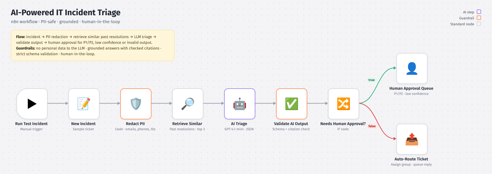
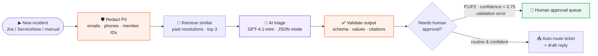
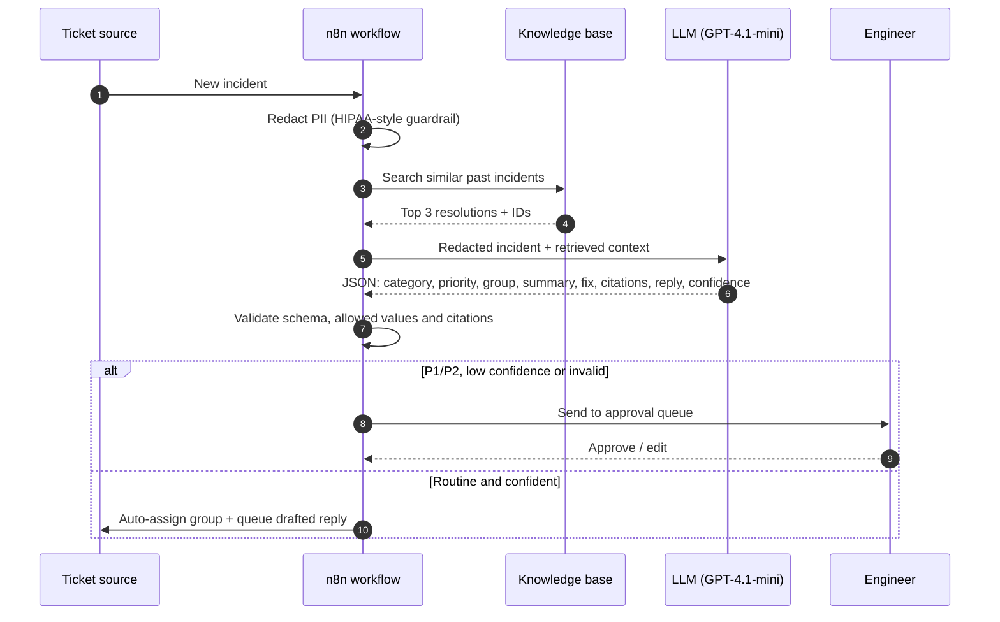

<div align="center">

# 🛡️ AI-Powered IT Incident Triage

**An n8n workflow that triages IT service-desk incidents with an LLM — built with the guardrails a regulated (HIPAA-style) enterprise needs.**




<sub>Workflow overview diagram — import <code>ai-incident-triage.json</code> into n8n to see the live canvas.</sub>

</div>

---

## ✨ Why this exists

Service desks lose hours every day reading, categorising and routing tickets. LLMs can do that triage in seconds — but in healthcare and finance you **cannot** send personal data to a model, accept unverified answers, or let an AI act on a critical outage unsupervised.

This workflow shows how to get the speed **and** keep control:

| | Capability |
|---|---|
| 🔒 | **PII never reaches the model** — emails, phone numbers and member IDs are redacted first |
| 📚 | **Grounded, not guessed** — the model only sees and cites real past resolutions |
| ✅ | **Output is validated, not trusted** — strict schema, allowed values, citation checks |
| 👤 | **Humans stay in charge** — P1/P2, low confidence or invalid output always go to an engineer |
| ⚡ | **Routine tickets fly** — confident, low-impact tickets are auto-routed with a drafted reply |

---

## 🧭 Architecture



### Decision logic



---

## 🧰 Tech stack

| Layer | Technology | Role |
|---|---|---|
| Orchestration | **n8n** (Manual Trigger, Set, Code, HTTP Request, IF) | Low-code workflow engine and visual canvas |
| LLM | **OpenAI GPT-4.1-mini** via Chat Completions, JSON mode, `temperature 0` | Triage, summary, suggested fix, draft reply |
| Retrieval | Keyword-scored knowledge base in a **JavaScript Code node** | Grounds the model in past resolutions (RAG pattern) |
| Guardrails | **JavaScript** regex redaction + schema validation | PII protection, output validation, citation checks |
| Human-in-the-loop | **IF node** routing to an approval queue | Keeps engineers in control of high-impact decisions |
| Security | n8n **credential store** for the API key | No secrets in the workflow file |
| Production targets | Jira Service Management · ServiceNow · Slack · Email · vector DB | Swap-in replacements for the demo nodes |

---

## 🔍 Node by node

| # | Node | Type | What it does |
|---|---|---|---|
| 1 | **Run Test Incident** | Manual Trigger | Starts the demo without needing a ticketing system |
| 2 | **New Incident (sample)** | Set | A realistic urgent Citrix outage for a Claims team |
| 3 | **Redact PII** | Code | Replaces emails, phone numbers and member IDs with `[EMAIL]`, `[PHONE]`, `[MEMBER_ID]` |
| 4 | **Retrieve Similar Past Resolutions** | Code | Scores a knowledge base of past incidents and keeps the top 3 |
| 5 | **AI Triage (GPT-4.1-mini)** | HTTP Request | Returns structured JSON triage grounded in the retrieved incidents |
| 6 | **Validate AI Output** | Code | Checks JSON, category, priority, group, confidence and that every citation was actually retrieved |
| 7 | **Needs Human Approval?** | IF | `true` for P1/P2, confidence < 0.75 or any validation error |
| 8 | **Human Approval Queue** | Set | Marks the ticket `PENDING_HUMAN_APPROVAL` |
| 9 | **Auto-Route Ticket** | Set | Marks the ticket `AUTO_ROUTED` with the suggested group |

### AI output contract

```json
{
  "category": "Access | Network | Email | Hardware | Software | Security",
  "priority": "P1 | P2 | P3 | P4",
  "assignment_group": "Citrix & VDI | Identity & Access | Messaging (M365) | Network Ops | Desktop Support | Security Ops",
  "summary": "max 2 sentences",
  "suggested_resolution": "steps for the engineer, based on past incidents",
  "cited_incidents": ["INC…"],
  "draft_reply": "short, polite update to the caller",
  "confidence": 0.0
}
```

Anything outside this contract is caught by **Validate AI Output** and sent to a human.

---

## 🚀 Quick start

1. **Open n8n** — [n8n Cloud](https://n8n.io) trial, or locally with `npx n8n`.
2. **Import** — *Workflows → Import from File* → `ai-incident-triage.json`.
3. **Add your key** — open **AI Triage (GPT-4.1-mini)** → *Credential* → *Create new* → OpenAI API key.
4. **Run** — click **Execute workflow**. The sample (urgent Citrix outage, P2) lands in the **Human Approval Queue**.

Try your own tickets by editing **New Incident (sample)** — see [`samples/sample-incident.json`](samples/sample-incident.json) for the format.

---

## 🏭 Production roadmap

- [ ] Replace the manual trigger with a **Jira Service Management** or **ServiceNow** trigger
- [ ] Replace the demo knowledge base with a **vector store** (e.g. Azure AI Search, pgvector) over historical tickets
- [ ] Replace the queue nodes with **Slack / Email “send and wait for approval”**
- [ ] Log every decision to an **audit table** for compliance reporting
- [ ] Add an **evaluation set** of labelled tickets to track triage accuracy over time

---

## 📁 Repository structure

```
├── ai-incident-triage.json      # n8n workflow (import this)
├── samples/
│   └── sample-incident.json     # example input ticket
└── docs/
    └── workflow-overview.png    # workflow diagram
```

---

<div align="center">

**Built by [Mohammed Imran Ali](https://linkedin.com/in/imran-ali-mohammed)** · Applied AI Engineer
11+ years in enterprise IT service delivery · author of *Python, Start to Agent*

<sub>All data in this repository is synthetic. No real patient, member or employee data is used.</sub>

</div>
